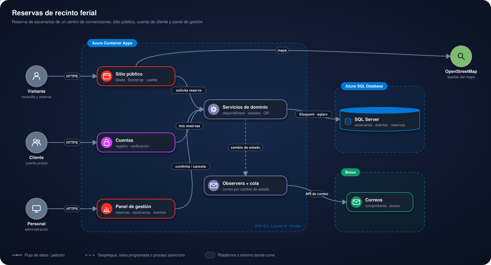

# Reservas de recinto ferial

<p>
  <a href="https://reservas-corferias.blueocean-86680030.eastus.azurecontainerapps.io/"></a>
  <a href="https://frontend-nine-topaz-99.vercel.app"></a>
  <a href="https://d4i3vsgw7xwmh.cloudfront.net"></a>
</p>


> 📘 **[Manual de usuario](docs/MANUAL.md)**: cómo usar cada pantalla, paso a paso y con imágenes.

## Contenido

1. [Presentación](#1-presentación)
2. [Funcionalidades](#2-funcionalidades)
3. [Arquitectura](#3-arquitectura)
4. [Estructura del proyecto](#4-estructura-del-proyecto)
5. [Instalación para pruebas](#5-instalación-para-pruebas)
6. [Autor y licencia](#6-autor-y-licencia)

---

## 1. Presentación

Aplicación web para reservar escenarios de un centro de convenciones y consultar la agenda de
eventos. Los visitantes revisan disponibilidad y solicitan reservas; el personal las gestiona desde
un panel. Es una reconstrucción en Laravel 12 de un proyecto académico escrito en Lumen 5.8.

- **Qué hace:** muestra los escenarios del recinto (salones, pabellones) con su capacidad, tarifa y
  fechas ocupadas, y recibe solicitudes de reserva con comprobante, código único y QR.
- **Para el personal:** un panel para confirmar o cancelar reservas y administrar escenarios y
  eventos; cada cambio de estado avisa por correo.
- **Cómo probarlo:** entra a la [demo](https://reservas-corferias.blueocean-86680030.eastus.azurecontainerapps.io/),
  elige un escenario y revisa su disponibilidad.

## 2. Funcionalidades

**Sitio público**
- Catálogo de escenarios con capacidad, tarifa, galería, mapa y fechas ocupadas.
- Agenda de eventos y suscripción por correo.
- Solicitud de reserva con validación de disponibilidad y comprobante con código único y QR.

**Cuenta de cliente**
- Registro con confirmación de correo y verificación en dos pasos obligatoria (app autenticadora o
  código por correo).
- Recuperación de contraseña y del autenticador.
- Historial de reservas propias y cancelación.

**Panel de gestión**
- Tablero con métricas, reservas con filtros, escenarios, eventos y cuentas del personal.

**En todas las pantallas:** adaptable a celular, tablet y computador; se instala como aplicación y
muestra una pantalla propia sin conexión.

## 3. Arquitectura

<p align="center">
  
</p>

| Capa | Tecnología |
|---|---|
| Aplicación | PHP 8.3 y Laravel 12 |
| Interfaz | Blade, Bootstrap 5 y CSS propio; mapa con Leaflet y OpenStreetMap |
| Datos | Eloquent sobre SQL Server |
| Avisos | Correo en cada cambio de estado de una reserva |
| Pruebas | PHPUnit en cada cambio; pruebas E2E diarias con Playwright |
| Despliegue | Contenedor que se publica solo desde GitHub en cada cambio a `main`, si pasan las pruebas |

## 4. Estructura del proyecto

```
app/
├── Http/          Controladores (público, cuentas y panel) y validación de formularios
├── Mail/          Plantillas de los correos
├── Models/        Escenario, Evento, Reserva, Suscriptor y Usuario
├── Observers/     Avisos por cambio de estado
└── Services/      Disponibilidad, estados, QR e imágenes
database/          Migraciones y datos de ejemplo
resources/views/   Vistas del sitio, del panel y de los correos
public/            Estilos, scripts e imágenes
tests/             Pruebas unitarias y de flujo
docs/              Manual de usuario y diagramas
```

## 5. Instalación para pruebas

1. Requisitos: PHP 8.3 con Composer 2 y una base SQL Server propia, o Docker.
2. Instala y prepara el proyecto:

   ```bash
   composer install
   cp .env.example .env
   php artisan key:generate
   ```

3. Completa `.env` con los datos de tu propia base (ese archivo no se sube al repositorio).
4. Crea las tablas con los datos de ejemplo y arranca:

   ```bash
   php artisan migrate --seed
   php artisan serve
   ```

   Con Docker: `docker compose up -d` y luego `docker compose exec app php artisan migrate --seed`.

5. Pruebas (no necesitan base de datos ni internet):

   ```bash
   php artisan test
   vendor/bin/pint --test
   ```

## 6. Autor y licencia

**Luis F. A.** · [GitHub](https://github.com/lariasca1994) · [LinkedIn](https://linkedin.com/in/lfac1)

Contacto: Telegram [@lfac6](https://t.me/lfac6) · WhatsApp [@carraian160](https://wa.me/carraian160) ·
[ariascluisf@hotmail.com](mailto:ariascluisf@hotmail.com)

Licencia: MIT.
