# 📘 Manual de usuario · Reservas de recinto ferial

## 1. Portada

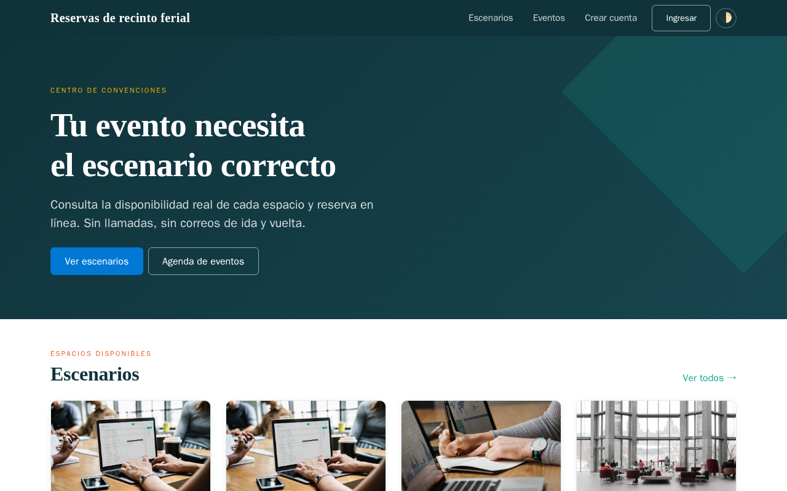

| | |
|---|---|
| **Producto** | Reservas de recinto ferial |
| **Documento** | Manual de usuario |
| **Versión** | 2.0 · noviembre de 2026 |
| **Dirigido a** | Personas y empresas que quieren reservar un escenario o consultar la agenda de eventos |
| **Dirección** | [Reservas de recinto ferial](https://reservas-corferias.blueocean-86680030.eastus.azurecontainerapps.io/) |
| **Autor** | Luis F. A. |

## Contenido

1. [Portada](#1-portada)
2. [Introducción](#2-introducción)
3. [Objetivo](#3-objetivo)
4. [Alcance](#4-alcance)
5. [Acceso al sistema](#5-acceso-al-sistema)
6. [Pantalla principal](#6-pantalla-principal)
7. [Navegación](#7-navegación)
8. [Funcionalidades](#8-funcionalidades)
9. [Gestión de perfil](#9-gestión-de-perfil)
10. [Mensajes frecuentes](#10-mensajes-frecuentes)
11. [Preguntas frecuentes](#11-preguntas-frecuentes)
12. [Glosario](#12-glosario)

---

## 2. Introducción

**Reservas de recinto ferial** muestra los escenarios de un centro de convenciones (salones y
pabellones) con su capacidad, tarifa y fechas ocupadas, y la agenda de eventos. Desde ahí solicitas
una reserva y recibes un comprobante con un código único y un código QR. El personal del recinto
confirma o cancela la solicitud y te avisa por correo.

Este manual explica cada pantalla, paso a paso y con imágenes.

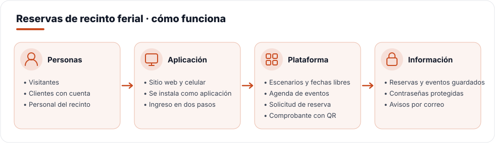

## 3. Objetivo

Que cualquier persona pueda, sin conocimientos técnicos:

- Consultar los escenarios, sus fechas libres y la agenda de eventos.
- Solicitar una reserva y guardar su comprobante.
- Crear una cuenta para ver y cancelar sus reservas.

## 4. Alcance

**Incluye:** catálogo de escenarios con galería y fechas ocupadas, agenda de eventos, solicitud de
reserva con comprobante y QR, suscripción a la agenda por correo, cuenta con verificación en dos
pasos, **Mis reservas** con cancelación, y uso en celular, tablet y computador.

**No incluye:** pagos en línea: el valor es estimado y el recinto acuerda el pago al confirmar.

**Qué necesitas:** un navegador actualizado y conexión a internet. Para consultar y solicitar una
reserva **no hace falta cuenta**; para **Mis reservas**, un correo propio y una app autenticadora
en el celular (o acceso a tu correo para recibir códigos).

## 5. Acceso al sistema

### 5.1 Crear una cuenta

Pulsa **Crear cuenta**.

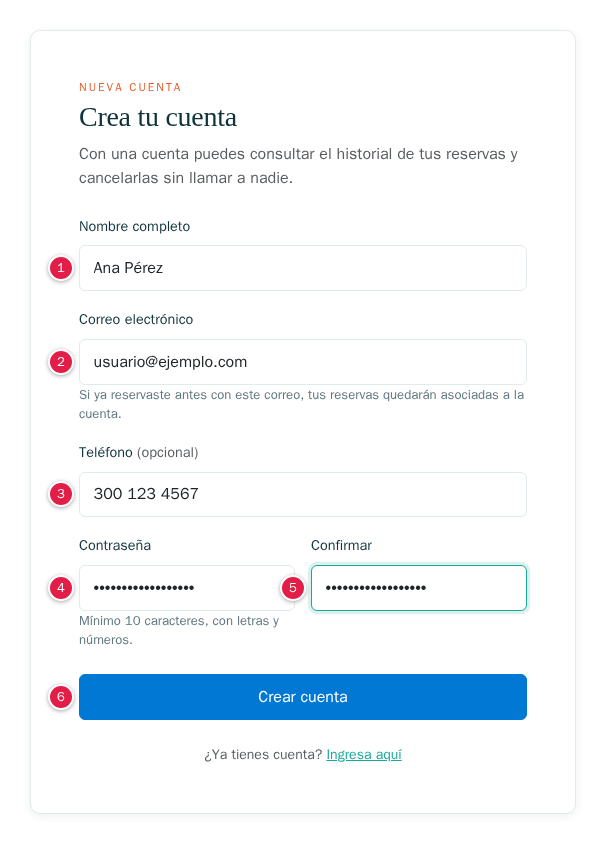

| # | Campo | Qué escribir |
|:-:|---|---|
| 1 | Nombre completo | Tu nombre, entre 3 y 120 caracteres |
| 2 | Correo electrónico | Un correo al que tengas acceso. Si ya reservaste con él, esas reservas pasan a tu cuenta |
| 3 | Teléfono | Opcional |
| 4 | Contraseña | Mínimo 10 caracteres, con letras y números |
| 5 | Confirmar | La misma contraseña |
| 6 | Crear cuenta | Crea la cuenta y te lleva a elegir tu verificación en dos pasos |

Después confirma tu correo con el enlace que te llega (revisa también la carpeta de spam): sin esa
confirmación no se habilita **Mis reservas**.

### 5.2 Iniciar sesión

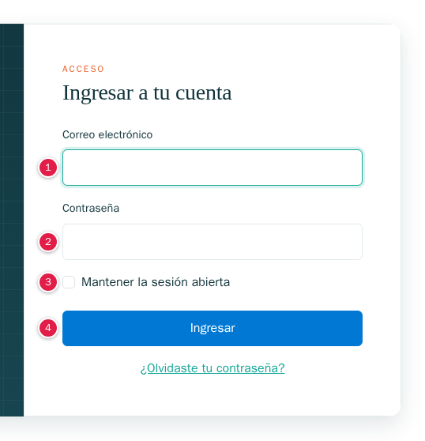

| # | Elemento | Qué hace |
|:-:|---|---|
| 1 | Correo | El correo de tu cuenta |
| 2 | Contraseña | Tu contraseña |
| 3 | Mantener la sesión abierta | Recuerda la sesión en ese equipo; no lo marques en equipos compartidos |
| 4 | Ingresar | Comprueba tus datos y pasa a la verificación en dos pasos |

### 5.3 Verificación en dos pasos

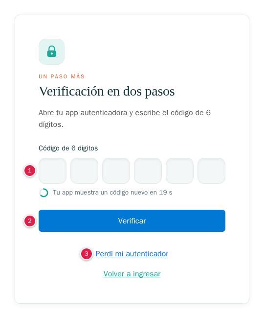

| # | Elemento | Qué hace |
|:-:|---|---|
| 1 | Código | Los 6 dígitos de tu app autenticadora (o de tu correo) |
| 2 | Verificar | Confirma el código y abre tu sesión |
| 3 | Perdí mi autenticador | Te envía un código al correo de la cuenta para configurar una app nueva |

### 5.4 Recuperar la contraseña

En el ingreso pulsa **¿Olvidaste tu contraseña?**.

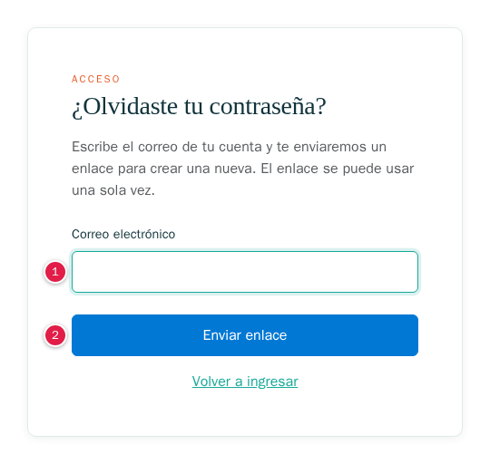

| # | Elemento | Qué hace |
|:-:|---|---|
| 1 | Correo electrónico | El correo de tu cuenta |
| 2 | Enviar enlace | Envía un enlace para crear una contraseña nueva (vence pronto y sirve una sola vez) |

Al guardar la contraseña nueva se cierran las sesiones abiertas y la verificación en dos pasos
sigue activa.

## 6. Pantalla principal

**Escenarios** es el catálogo del recinto.

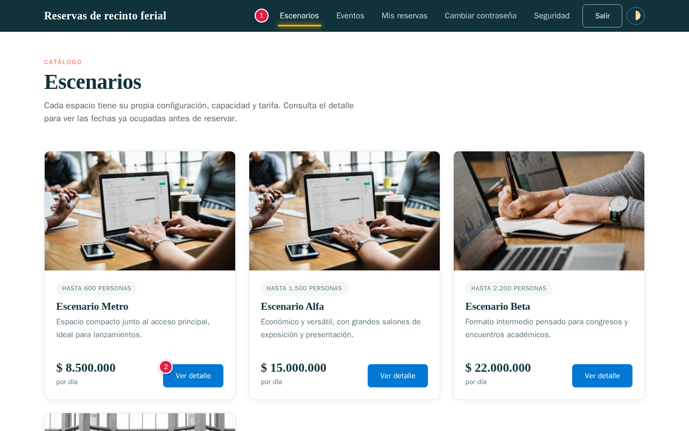

| # | Elemento | Qué hace |
|:-:|---|---|
| 1 | Menú | Lleva a Escenarios, Eventos, Mis reservas, Cambiar contraseña y Seguridad |
| 2 | Ver detalle | Abre el escenario con su galería, lo que incluye y sus fechas ocupadas |

Cada tarjeta muestra la capacidad máxima y la tarifa por día. En la página de inicio está además
el mapa del recinto.

## 7. Navegación

En el computador el menú está arriba; el botón ◐ cambia entre tema claro y oscuro. En la tablet y
en el celular el menú pasa a una barra inferior con Inicio, Escenarios, Eventos, Reservas y **Más**
(Cambiar contraseña, Seguridad y Salir).

| Tablet en vertical | Celular |
|:-:|:-:|
| 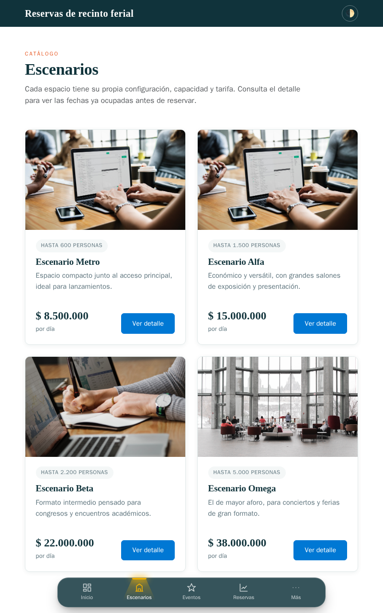 | 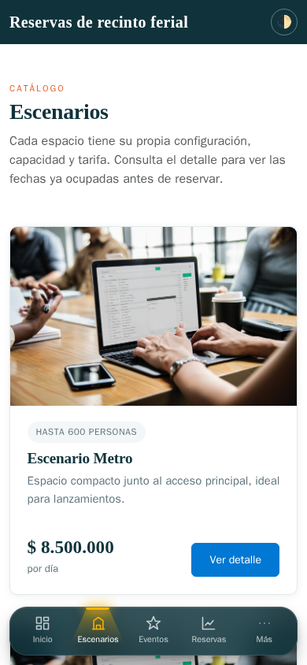 |

## 8. Funcionalidades

### 8.1 Crear: solicitar una reserva

Desde un escenario pulsa **Solicitar reserva**.

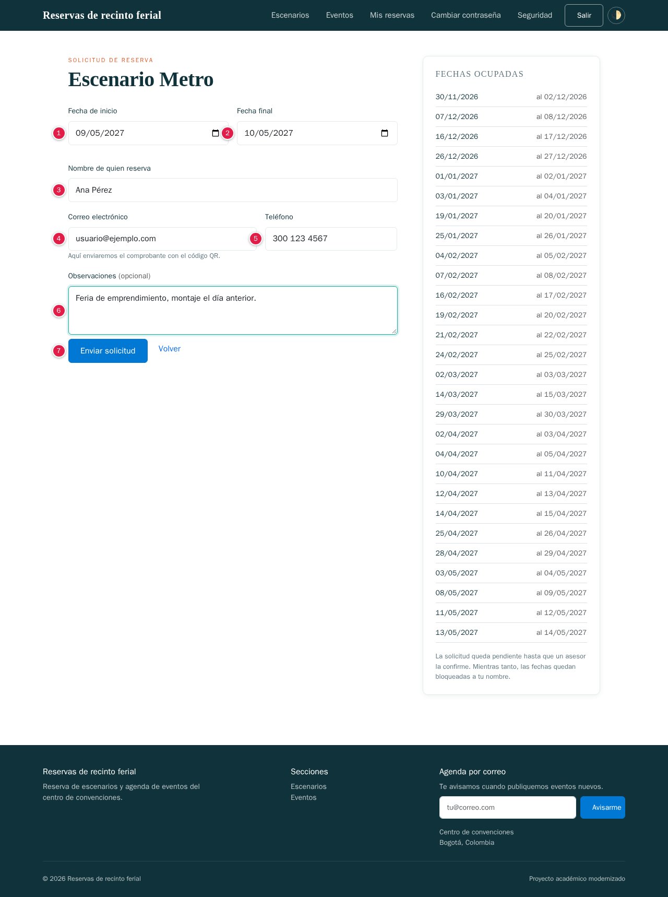

| # | Campo | Qué escribir |
|:-:|---|---|
| 1 | Fecha de inicio | El primer día del evento: hoy o una fecha futura |
| 2 | Fecha final | El último día: igual o posterior a la de inicio |
| 3 | Nombre de quien reserva | La persona responsable |
| 4 | Correo electrónico | Donde llegan el comprobante y los avisos |
| 5 | Teléfono | Un número de contacto |
| 6 | Observaciones | Detalles del evento (opcional) |
| 7 | Enviar solicitud | Registra la solicitud como pendiente de confirmación |

A la derecha ves las **fechas ocupadas**: si eliges días que se cruzan con una reserva, la
solicitud no se registra.

### 8.2 Consultar: escenarios y eventos

El detalle de un escenario muestra su galería, la descripción, **Qué incluye** y las fechas ya
ocupadas:

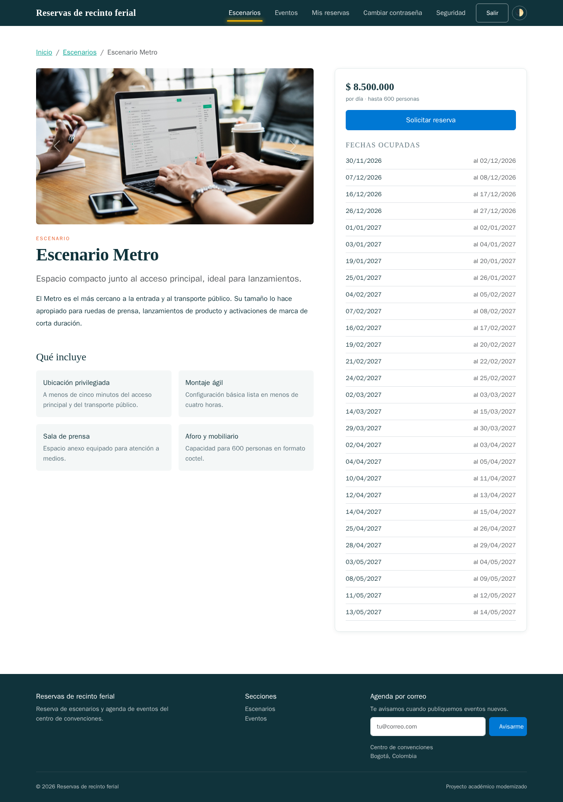

**Eventos** muestra la agenda de eventos programados. Para recibirla por correo, escribe tu correo
al pie de la página y pulsa **Avisarme**; cada correo trae un enlace para darte de baja.

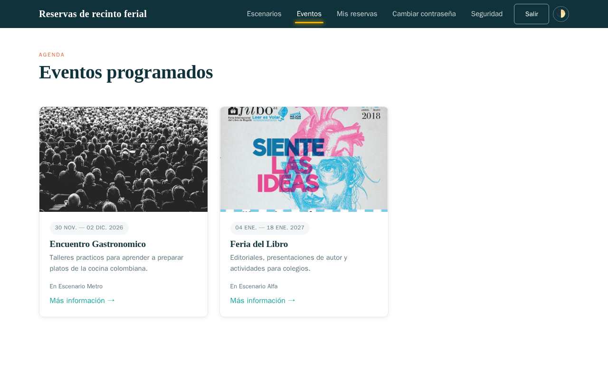

Con tu cuenta, **Mis reservas** lista tus solicitudes con su código, escenario, fechas, valor y
estado:

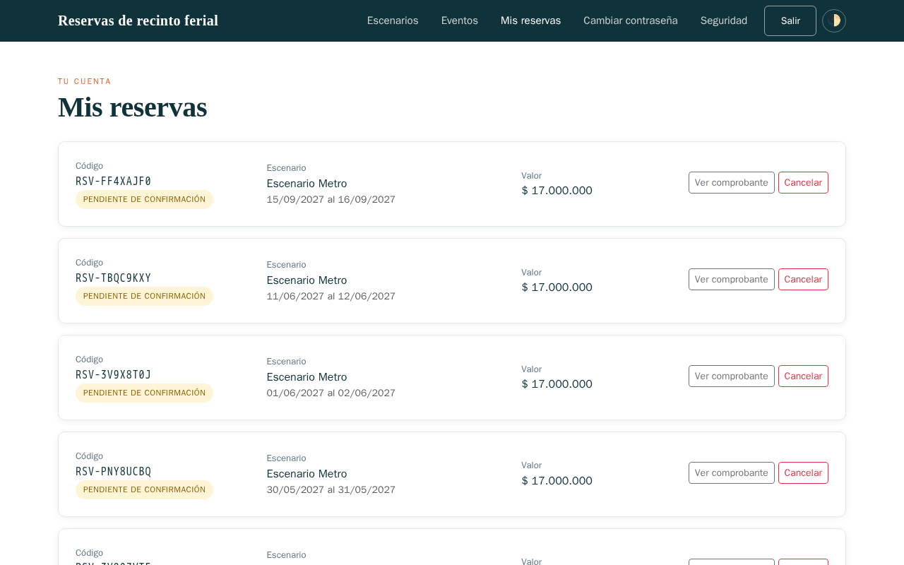

### 8.3 Modificar: cancelar una reserva

En **Mis reservas**, cada reserva tiene **Ver comprobante** (1) y **Cancelar**. Al cancelar, las
fechas quedan libres de nuevo y te llega un aviso por correo. Para cambiar las fechas, cancela y
solicita otra reserva.

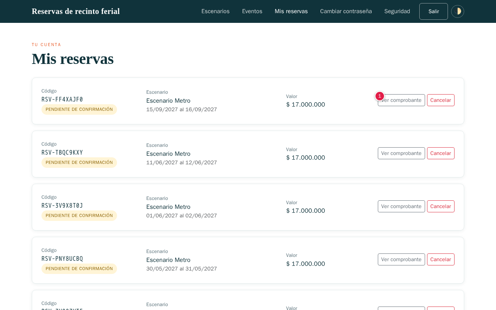

### 8.4 Reportar: el comprobante

El comprobante resume la reserva: código, estado, escenario, fechas, días, nombre y valor
estimado, con un código QR para consultarla. Pulsa **Imprimir** para guardarlo en papel o en PDF.

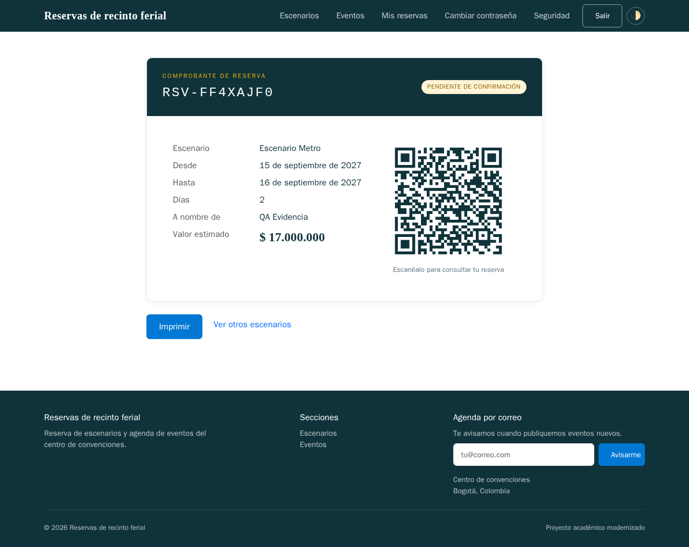

Guarda el código como un dato privado: quien tenga el enlace del comprobante ve los datos de
contacto de la reserva.

## 9. Gestión de perfil

### 9.1 Cambiar contraseña

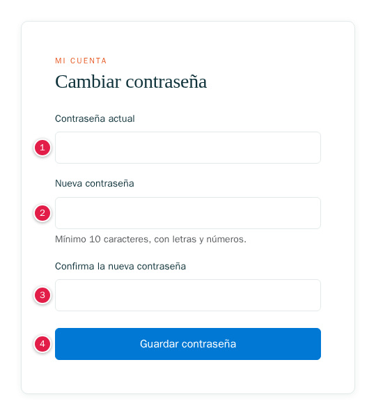

| # | Campo | Qué escribir |
|:-:|---|---|
| 1 | Contraseña actual | Tu contraseña de hoy |
| 2 | Nueva contraseña | Mínimo 10 caracteres, con letras y números |
| 3 | Confirma la nueva contraseña | La misma contraseña nueva |
| 4 | Guardar contraseña | Guarda el cambio; las demás sesiones abiertas se cierran |

### 9.2 Seguridad

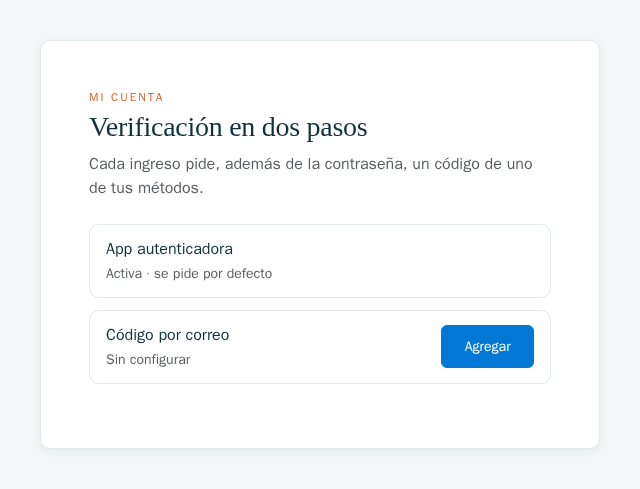

Muestra tus métodos de verificación. Con **Agregar** activas el que no elegiste (app autenticadora o
código por correo) y escoges cuál se pide por defecto; tener los dos te permite entrar aunque no
tengas el teléfono a mano.

## 10. Mensajes frecuentes

| Mensaje | Qué significa | Qué hacer |
|---|---|---|
| Las credenciales no coinciden con nuestros registros. | El correo o la contraseña no coinciden | Revísalos o usa **¿Olvidaste tu contraseña?** |
| Demasiados intentos fallidos. Espera unos minutos e inténtalo de nuevo. | El ingreso se bloqueó un rato por seguridad | Espera unos minutos |
| El código no es correcto o ya venció. | El código no sirve | Escribe el código que muestra la app ahora |
| El escenario no está disponible entre … y … | Esas fechas ya están reservadas | Elige otras fechas libres |
| La fecha de inicio no puede estar en el pasado. | La fecha ya pasó | Elige hoy o una fecha futura |
| La fecha final no puede ser anterior a la de inicio. | Las fechas están al revés | Corrige la fecha final |
| Tu solicitud de reserva quedó registrada. | La solicitud se guardó | Guarda el comprobante |
| El enlace no es válido o ya venció. Pide uno nuevo. | El enlace de recuperación ya no sirve | Pide uno nuevo |
| Tu contraseña quedó actualizada. | El cambio se guardó | Ingresa con la contraseña nueva |
| Página no encontrada | La dirección no existe | Usa **Ver escenarios** o **Volver al inicio** |
| Sin conexión | Tu equipo no tiene internet | La pantalla reintenta sola |

| Página no encontrada | Sin conexión |
|:-:|:-:|
| 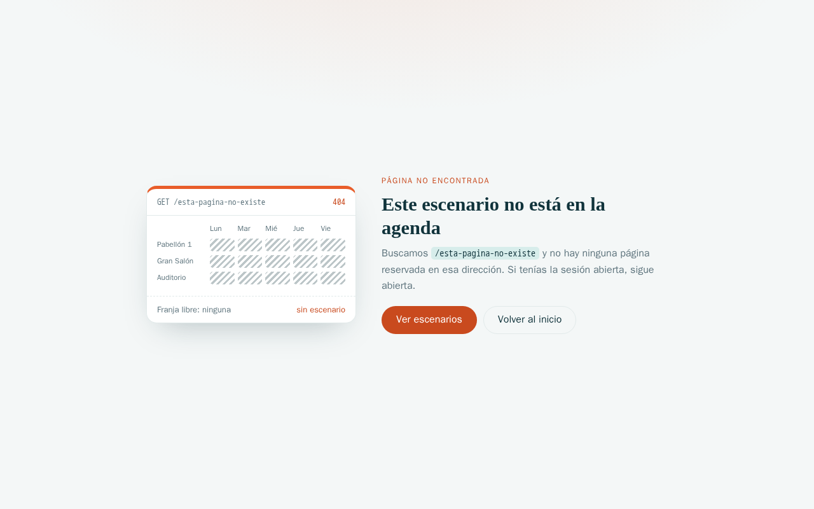 | 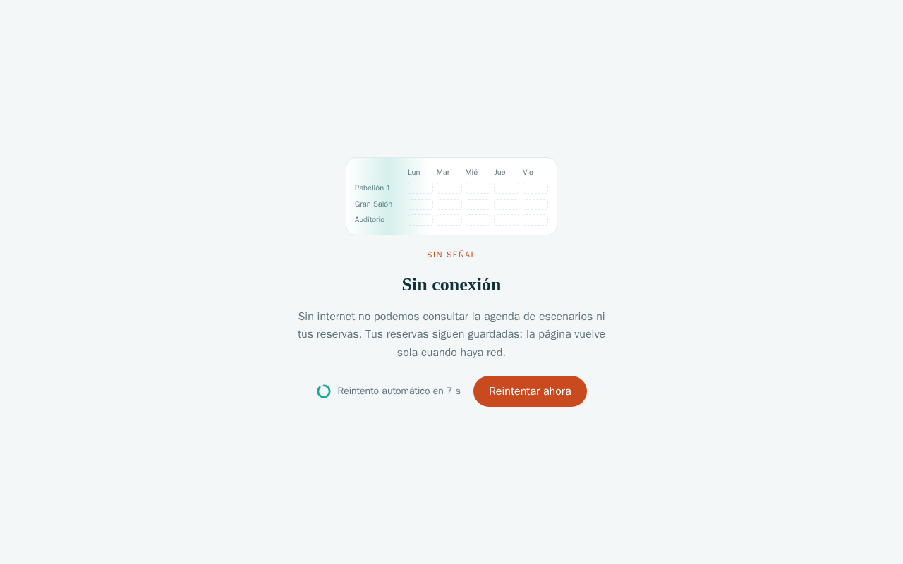 |

## 11. Preguntas frecuentes

**¿Necesito cuenta para reservar?** No. La cuenta solo sirve para ver tus reservas y cancelarlas.

**Reservé sin cuenta y luego me registré, ¿veo esa reserva?** Sí, si usaste el mismo correo: al
confirmarlo, la reserva pasa a tu cuenta.

**¿Por qué no puedo elegir ciertas fechas?** El escenario ya tiene una reserva en esos días; revisa
las fechas ocupadas del escenario.

**¿Por qué a veces aparece "En mantenimiento" al entrar?** El servicio se suspende cuando nadie lo
usa y tarda un momento en reactivarse. Tus reservas no se pierden.

**¿Se puede instalar como aplicación?** Sí: en Chrome o Edge, **Instalar aplicación**; en iPhone,
Safari → **Compartir → Agregar a inicio**.

**¿Dónde pido ayuda o reporto un problema?** Telegram [@lfac6](https://t.me/lfac6), WhatsApp
[@carraian160](https://wa.me/carraian160) o [ariascluisf@hotmail.com](mailto:ariascluisf@hotmail.com).

## 12. Glosario

| Término | Qué significa |
|---|---|
| **Comprobante** | Resumen de tu reserva con su código y un código QR |
| **Código de reserva** | Identificador único de la reserva, por ejemplo RSV-7K2P9QXA |
| **Código QR** | Cuadro de puntos que el celular lee con la cámara para abrir el comprobante |
| **Escenario** | Salón o pabellón del recinto que se puede reservar |
| **Fechas ocupadas** | Días en que el escenario ya tiene una reserva |
| **Pendiente de confirmación** | La solicitud está registrada y espera la respuesta del recinto |
| **Verificación en dos pasos** | Además de la contraseña, se pide un código que solo tú puedes recibir |
