# 📘 Manual de usuario · Reservas de Recinto Ferial

Guía para usar la plataforma paso a paso: qué significa cada campo, qué datos se ingresan y qué
protege la plataforma. Para la parte técnica vuelve al [README](../README.md).

**Demo:** [Reservas Corferias (Azure Container Apps)](https://reservas-corferias.blueocean-86680030.eastus.azurecontainerapps.io/)

## Contenido

1. [Proyecto: objetivos y alcances](#1-proyecto-objetivos-y-alcances)
2. [Glosario](#2-glosario)
3. [Plataformas, base de datos y servicios](#3-plataformas-base-de-datos-y-servicios)
4. [Paso a paso](#4-paso-a-paso)
5. [Seguridad: tu información protegida](#5-seguridad-tu-información-protegida)
6. [Agradecimientos](#6-agradecimientos)

---

## 1. Proyecto: objetivos y alcances

### Objetivo

Sistema de reservas de un centro de convenciones: cualquiera consulta los escenarios (salones,
pabellones), sus fechas ocupadas y la agenda de eventos, y solicita una reserva. El personal del
recinto confirma o cancela las solicitudes desde un panel de gestión.

### Alcance: qué necesitas y qué esperar

- Solo necesitas un navegador. Para consultar y solicitar una reserva **no hace falta cuenta**.
- La base de datos (Azure SQL sin servidor) se pausa sin uso y tiene una cuota gratuita mensual.
  Si ves esta página, la base está encendiéndose o se agotó la cuota del mes: vuelve a intentarlo
  más tarde. Tus reservas no se pierden.

  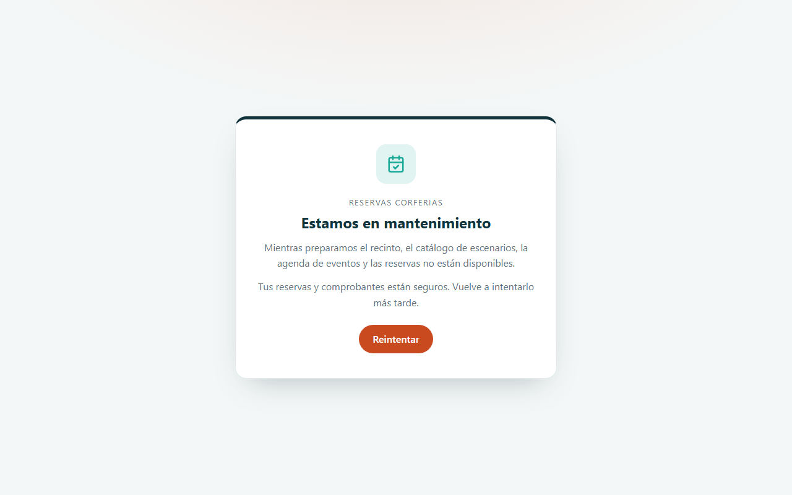

### Límites

- **Guarda tu código de reserva como un dato privado:** quien tenga el enlace del comprobante ve el
  nombre, correo y teléfono de contacto.
- Es una demo académica: no uses datos de contacto reales de terceros.
- Si la base agotó su cuota gratuita del mes, la plataforma muestra la página de mantenimiento
  hasta el mes siguiente.

## 2. Glosario

Palabras técnicas que aparecen en este manual, explicadas en lenguaje simple.

| Término | Qué significa |
|---|---|
| **Administrador** | Cuenta con permisos para gestionar usuarios y configuraciones de la aplicación. |
| **API** | Puerta de entrada de un programa para que otros programas le pidan o le envíen datos. |
| **Base de datos** | Lugar donde la aplicación guarda la información de forma ordenada y permanente. |
| **Cifrado / TLS / HTTPS** | Protección que codifica la información mientras viaja, para que nadie en el camino pueda leerla. |
| **Contraseña cifrada (hash)** | La contraseña no se guarda tal cual, sino como una "huella" de la que no se puede recuperar el texto original. |
| **Cookie** | Pequeño dato que el navegador guarda para recordar tu sesión en ese sitio. |
| **Código QR** | Cuadro de puntos que el celular lee con la cámara para abrir un enlace o un cobro. |
| **Despliegue** | Publicar una nueva versión de la aplicación para que esté disponible en internet. |
| **Modo mantenimiento** | Pantalla que aparece cuando el servicio o su base de datos no responden; se recupera sola cuando vuelven. |
| **Navegador** | Programa con el que abres páginas web: Chrome, Edge, Firefox, Safari. |
| **Nube** | Servidores de una empresa (Amazon, Microsoft, Google, Oracle…) donde la aplicación funciona sin depender de un computador propio. |
| **Rate limit (límite de intentos)** | Tope de intentos en poco tiempo, para frenar a quien intenta adivinar contraseñas. |
| **Rol** | Tipo de cuenta que define qué puede hacer cada persona (por ejemplo, usuario o administrador). |
| **Servidor** | Computador en la nube que atiende las peticiones de la aplicación. |
| **Sesión** | El tiempo en que la aplicación te reconoce después de iniciar sesión, sin pedirte la contraseña de nuevo. |
| **Token** | Credencial temporal que la aplicación te entrega al iniciar sesión, en lugar de enviar tu contraseña en cada paso. |
| **Variables de entorno / secretos** | Claves y contraseñas internas de la aplicación, guardadas fuera del código para que no queden expuestas. |

## 3. Plataformas, base de datos y servicios

Qué servicio de nube, base de datos o API usa el proyecto y para qué sirve cada uno.

| Plataforma | Tipo | Qué hace en el proyecto |
|---|---|---|
|  | Nube | Corre la aplicación Laravel 12 en una imagen Docker propia: sitio público, cuentas de cliente y panel de gestión. |
|  | Base de datos | Guarda escenarios, eventos, reservas, suscriptores y usuarios. Obligatoria. |
|  | API / servicio externo | Entrega por su API HTTP los avisos por correo de cada cambio de estado. Opcional: en desarrollo los correos se escriben en el log. |
|  | API / servicio externo | Teselas del mapa del recinto con Leaflet, sin registro ni clave de API. |
|  | Automatización | Ejecuta pruebas y estilo, publica la imagen en GitHub Container Registry y crea la nueva revisión de la Container App. |
|  | Pruebas automatizadas | Prueba la demo automáticamente y publica la evidencia. |

## 4. Paso a paso

### 4.1 Explorar sin cuenta

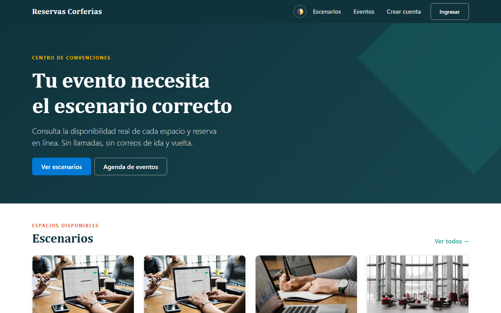

- **Escenarios:** cada tarjeta muestra capacidad y tarifa por día. Con **Ver detalle** ves la
  galería, **Qué incluye**, el mapa y el calendario de fechas ocupadas.

  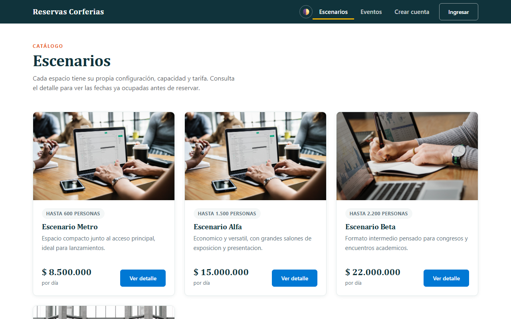

  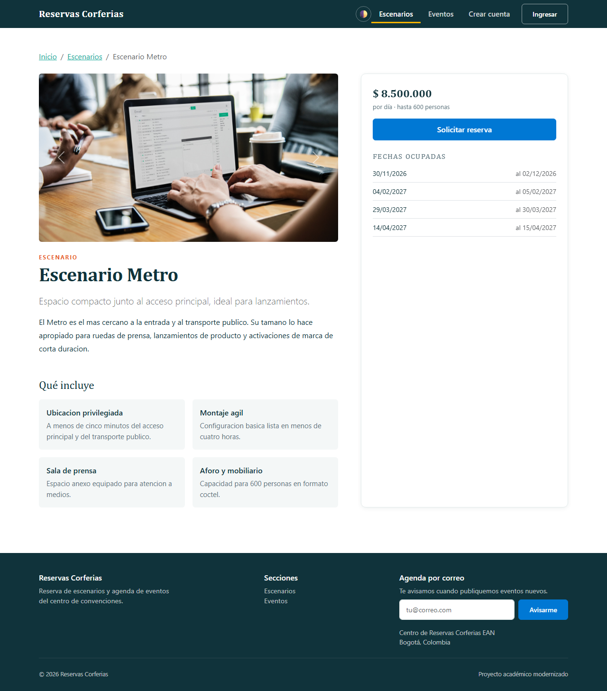

- **Eventos:** la agenda de **Eventos programados**.

  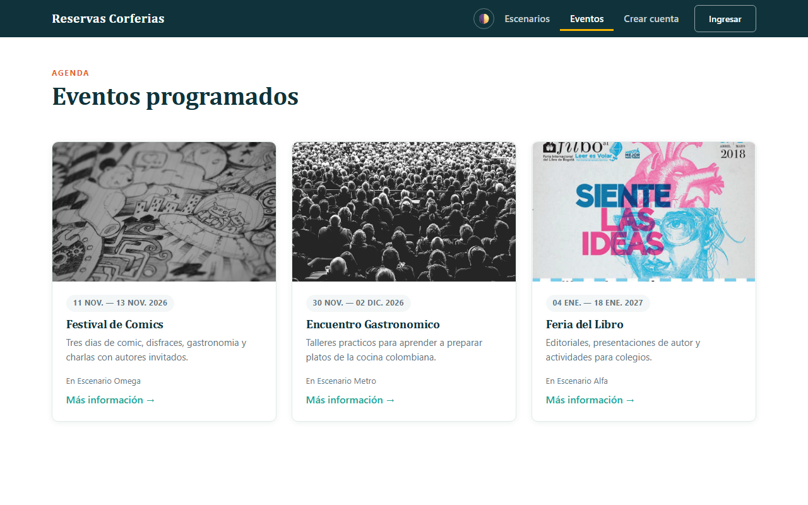

- **Agenda por correo** (pie de página): escribe tu correo y pulsa **Avisarme** para recibir los
  eventos nuevos. Cada correo trae un enlace para darte de baja.

### 4.2 Solicitar una reserva

Desde un escenario, pulsa **Solicitar reserva**:

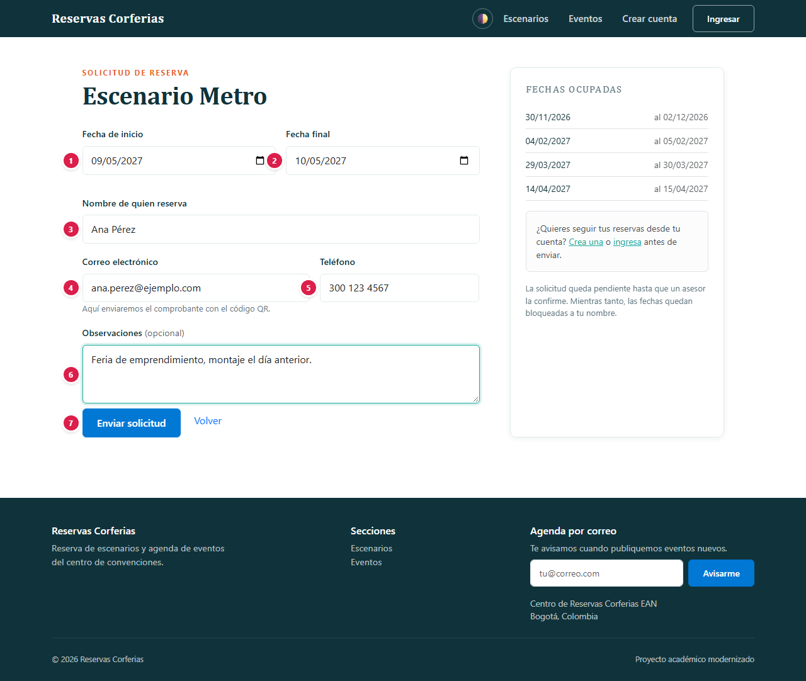

| # | Campo | Qué escribir | Reglas |
|:-:|---|---|---|
| 1 | Fecha de inicio | Primer día del evento | Hoy o una fecha futura; se valida que el escenario esté libre |
| 2 | Fecha final | Último día del evento | Igual o posterior a la de inicio |
| 3 | Nombre de quien reserva | Responsable de la reserva | Entre 3 y 120 caracteres |
| 4 | Correo electrónico | Donde llegan el comprobante y los avisos | Formato válido |
| 5 | Teléfono | Contacto | Entre 7 y 40 caracteres |
| 6 | Observaciones | Detalles del evento | Opcional, máximo 500 caracteres |
| 7 | Enviar solicitud | Botón | Registra la solicitud en estado pendiente |

Al enviar recibes un **comprobante con código único** (por ejemplo `RSV-7K2P9QXA`) y un código QR,
que puedes **Imprimir**. El personal confirma o cancela la solicitud y te avisa por correo.

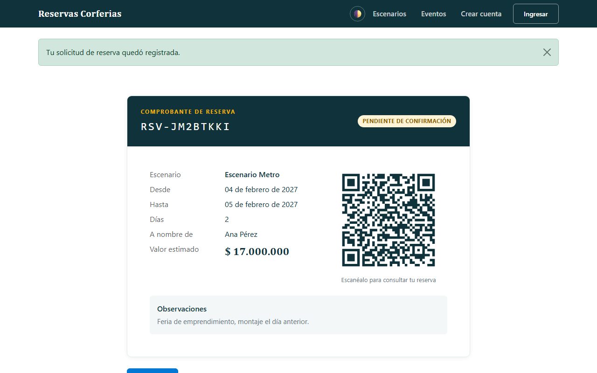

### 4.3 Crear una cuenta (opcional)

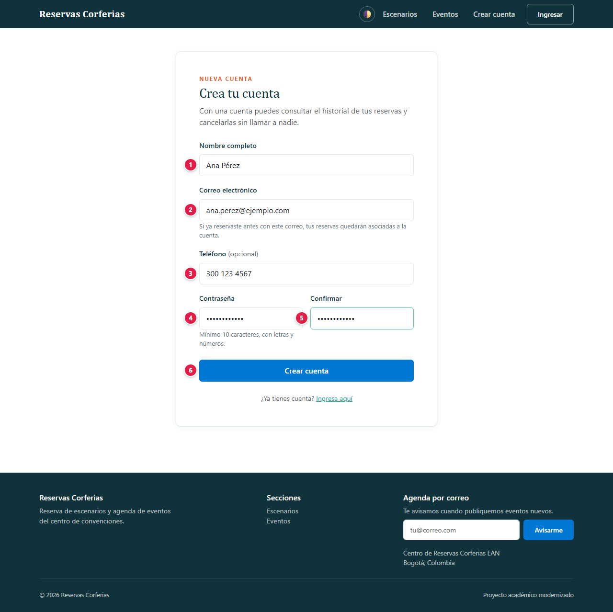

| # | Campo | Qué escribir | Reglas |
|:-:|---|---|---|
| 1 | Nombre completo | Tu nombre | Entre 3 y 120 caracteres |
| 2 | Correo electrónico | Tu correo; si ya reservaste con él, esas reservas se asocian a tu cuenta al verificarlo | Único; se verifica con un enlace |
| 3 | Teléfono | Opcional | — |
| 4 | Contraseña | Tu contraseña | Mínimo **10 caracteres, con letras y números** |
| 5 | Confirmar | La misma contraseña | Debe coincidir |
| 6 | Crear cuenta | Botón | Crea la cuenta y envía el correo de verificación |

Confirma tu correo con el enlace que te llega: sin esa verificación no se habilita **Mis
reservas**. Si no llegó, pulsa **Reenviar el enlace** (revisa también la carpeta de spam).

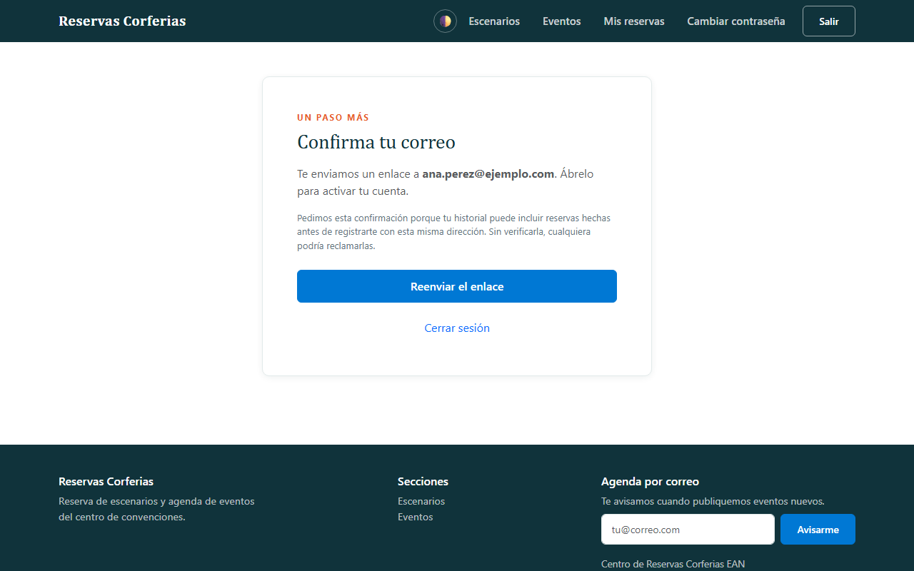

### 4.4 Ingresar

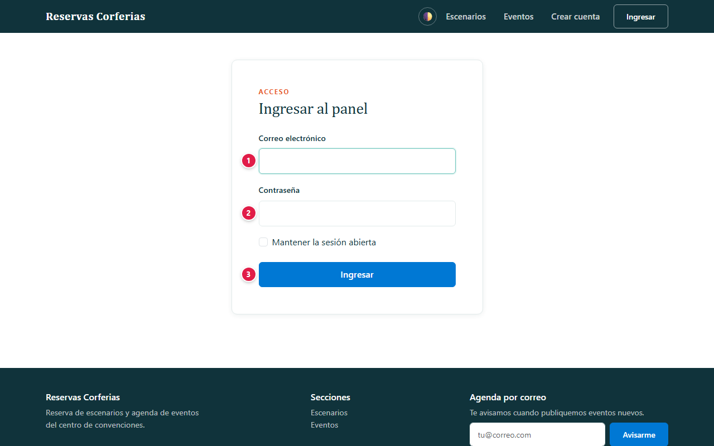

| # | Campo | Qué escribir |
|:-:|---|---|
| 1 | Correo | El correo de tu cuenta |
| 2 | Contraseña | Tu contraseña |
| 3 | Ingresar | Entra a la plataforma |

Tras **5 intentos fallidos** con el mismo correo desde la misma conexión, el ingreso se bloquea
unos minutos.

### 4.4.1 Olvidé mi contraseña

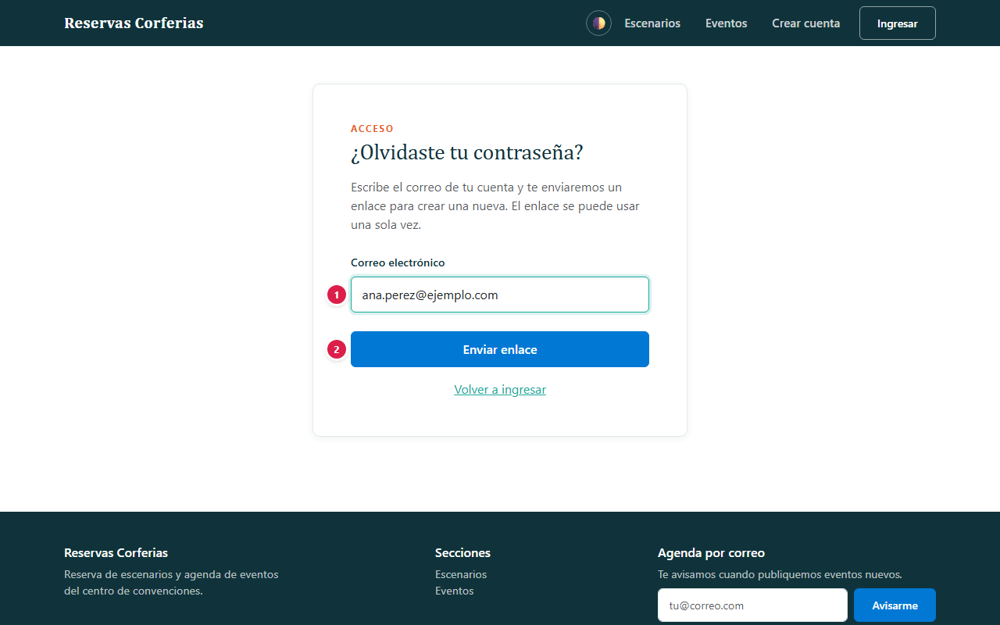

En **Ingresar**, pulsa **¿Olvidaste tu contraseña?** y escribe el correo de tu cuenta. Si la cuenta existe y
está activa, te llega un correo con un enlace para crear una contraseña nueva (mínimo 10 caracteres,
con letras y números). El enlace vence en 60 minutos y sirve una sola vez. Por seguridad, la
pantalla muestra el mismo mensaje exista o no la cuenta.

### 4.4.2 Cambiar la contraseña

Con la sesión iniciada, abre **Cambiar contraseña** (en el menú, o en la barra lateral del panel),
escribe la contraseña actual y la nueva dos veces. Las demás sesiones abiertas se cierran.

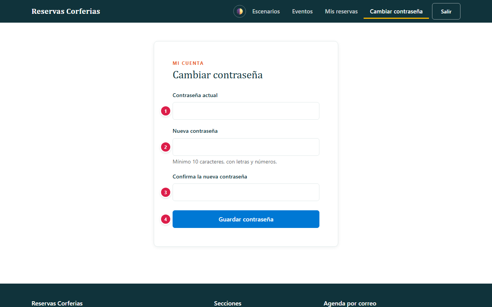

| # | Campo | Qué escribir |
|:-:|---|---|
| 1 | Contraseña actual | La que usas hoy |
| 2 | Nueva contraseña | Mínimo 10 caracteres, con letras y números |
| 3 | Confirma la nueva contraseña | La misma del campo 2 |
| 4 | Guardar contraseña | Botón |

### 4.5 Mis reservas

Con la cuenta verificada, **Mis reservas** lista tus solicitudes con su estado (pendiente,
confirmada o cancelada) y permite **cancelar** las tuyas.

### 4.6 Panel de gestión (personal del recinto)

| Rol | Qué hace |
|---|---|
| Cliente | Crea su cuenta, solicita reservas y gestiona las suyas |
| Operador | Confirma o cancela reservas; crea, edita o elimina escenarios y eventos; envía la agenda a los suscriptores |
| Administrador | Lo mismo que el operador y, además, gestiona las cuentas del personal |

Las cuentas del personal no se pueden crear desde el registro público: las iniciales se crean en
el despliegue y las siguientes las crea el administrador.

### 4.7 Preguntas frecuentes

**¿Necesito cuenta para reservar?** No. La cuenta solo sirve para ver el historial y cancelar sin
contactar al recinto.

**Reservé sin cuenta y luego me registré, ¿veo esa reserva?** Sí, si usaste el mismo correo: al
verificarlo, queda asociada a tu cuenta.

**¿Por qué no me deja elegir ciertas fechas?** El escenario ya tiene una reserva en ese rango; el
calendario del escenario muestra las fechas ocupadas.

## 5. Seguridad: tu información protegida

Tu confianza es lo primero: la plataforma solo pide los datos necesarios para funcionar, los protege y no los comparte con terceros. Esto es lo que se guarda y cómo se protege.

### Qué datos se guardan y dónde

| Dato | Para qué se usa | Dónde se guarda | Quién lo ve |
|---|---|---|---|
| Nombre, correo y teléfono de la reserva | Contactarte y enviarte el comprobante | Azure SQL | Tú (con el código o en Mis reservas) y el personal |
| Cuenta: nombre, correo, teléfono | Identificarte | Azure SQL | Tú y el personal |
| Contraseña | Iniciar sesión | Azure SQL, **solo su huella bcrypt** | Nadie: no se puede leer ni recuperar |
| Correo de la agenda | Avisarte de eventos | Azure SQL, con un token de baja | El personal |
| Sesión | Mantenerte conectado | Cookie de Laravel en tu navegador | Cifrada por el servidor, invisible para JavaScript |

### Cómo se protege tu información

Comprobado en el código del proyecto (`routes/web.php`, `app/Http/Controllers`,
`app/Http/Requests`, `app/Models`):

- **Contraseñas con bcrypt** (conversión `hashed` de Laravel) y política de 10 caracteres con
  letras y números.
- **Verificación de correo obligatoria** para usar **Mis reservas**.
- **Límites de intentos:** 5 ingresos fallidos por correo y conexión; además, límites por minuto
  en ingreso (20), registro (10), solicitudes de reserva (10), consulta de comprobantes (30),
  reenvío de verificación (6) y suscripciones (5).
- **Comprobantes no adivinables:** se consultan por un código aleatorio (`RSV-` + 8 caracteres),
  nunca por un número consecutivo.
- **Roles en el servidor:** el panel exige una cuenta del personal y la gestión de usuarios exige
  rol administrador.
- **Versión de PHP vigilada:** la imagen fija PHP 8.3.36, que corrige *php2shell*
  (CVE-2026-109618 y CVE-2026-109619); la compilación falla si la versión fuera anterior. El
  progreso de subidas en sesión está desactivado y el servidor no anuncia su versión de PHP.
- **Protección CSRF** en todos los formularios (token de Laravel) y validación en el servidor de
  cada campo (longitudes, formatos y fechas).
- **Consultas con Eloquent** (parametrizadas) y plantillas Blade con escape automático.
- **Secretos fuera del repositorio:** conexión a Azure SQL, clave de la aplicación y SMTP en los
  secretos de la Container App.

## 6. Agradecimientos

A mi familia, por su apoyo incondicional, su paciencia y por creer en cada proyecto incluso cuando apenas era una idea. Este trabajo también es de ustedes.

Y a ti, que usas esta plataforma: cada prueba, comentario y sugerencia ayuda a que siga mejorando.
